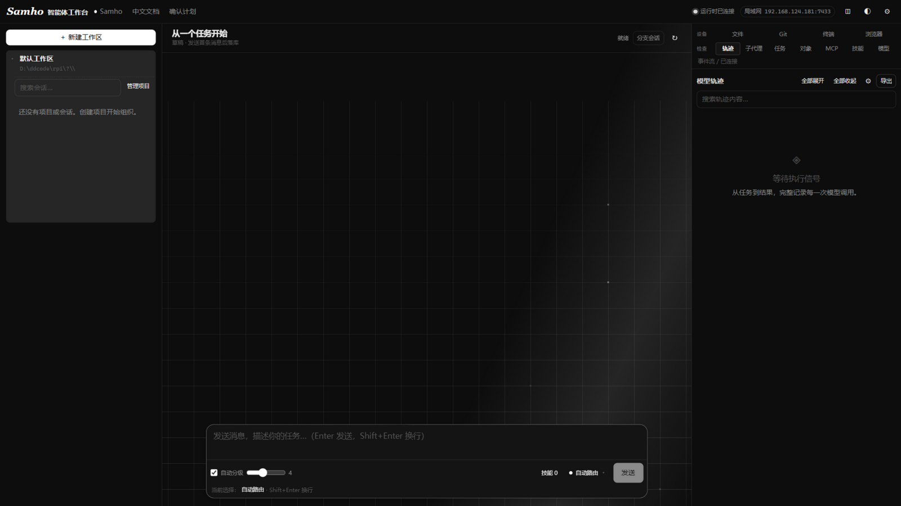
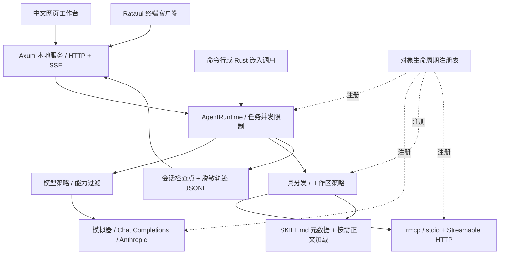

<div align="center">

# Samho

**本地优先的 Agent 运行时 —— 一份 Rust 核心，同时驱动网页工作台与终端 TUI**

*A local-first agent runtime in Rust: one shared core serving both a web workbench and a terminal UI.*

[](https://github.com/Sam5440/samho/actions/workflows/ci.yml)
[](LICENSE)




</div>

---

Samho 把一个编码智能体所需的全部基础设施——异步运行时、模型接入、工具管线、会话持久化、调用轨迹——实现在一个 Rust 核心（`samho-core`）里，再通过本地 HTTP/SSE 服务把同一份运行时状态同时提供给 **React 网页工作台** 与 **Ratatui 终端界面**。模型接入完全由使用者配置：默认 Provider 是明确标注 `[DEMO simulation]` 的离线模拟器，装好即可跑通全流程，接上真实网关即可真实推理。

未完成的能力按[实现状态](docs/implementation-status.md)保留边界，不做超出证据的宣称。

## ✨ 特性总览

**运行时核心**

- 统一 **Object** 契约：运行时、模型、工具、Skill、MCP 服务、Session、Task 全部实现稳定 ID、依赖拓扑、失败回滚与逆序销毁
- scope / middleware / lease / generation 热替换；自定义 Rust 工具可在运行锁下验证、激活、失败移除
- 异步 Agent 循环：任务并发限制、取消、失败状态、会话持久化与重启恢复
- 项目制工作区：项目 / 文件夹 / 会话树，会话可挂附属终端与浏览器标签（重启后恢复）；支持多工作区、各自独立 `data_dir`

**模型接入与路由**

- 六级模型策略 `nano / fast / balanced / reasoning / frontier / specialist`，可配置分类规则、评分权重、上下文、预算、延迟与能力约束；手动指定 tier 或 model
- Chat Completions 兼容与 Anthropic Messages 双协议流式 Provider；429/5xx/超时分类重试、失败降级路由、决策理由写入轨迹（`model.route`）
- 请求前预算预留与结算；上下文窗口、费用、能力全部显式声明

**工具与扩展**

- 内置工具带：`read / write / edit / list_files / glob / grep / webfetch / todo / shell`，默认全开、可逐项关闭
- MCP（`rmcp 3.5.1`）：stdio + Streamable HTTP、工具/资源/模板/prompts、分页、超时、取消、子进程回收、OAuth PKCE
- Skill：`SKILL.md` frontmatter 校验、确定性发现与冲突诊断、按需正文加载、显式用户调用
- 远程 Facet：受认证与 allowlist 保护的版本化握手 HTTP 客户端

**双端界面**

- 网页工作台：React 19 + TypeScript + Vite + Tailwind v4 + shadcn/ui，构建为单文件产物内嵌进二进制，满足严格 CSP；完整 Markdown 渲染（GFM 表格、代码高亮、数学公式、净化后的内联 HTML），HTML 代码块与 workspace 网页在隔离沙箱中运行预览
- 终端 TUI：与网页功能对齐——流式 Markdown 对话、任务看板、轨迹/预算/模型角色面板、文件树与多行编辑器、Git 审查、PTY 终端接管（`Ctrl+Q` 脱离保活）、浏览器文本模式

**数据与轨迹**

- JSONL trace + SQLite/文件 journal：单调序号、trace/session/span 关联、路由理由、工具参数与结果摘要、usage、耗时
- 脱敏、导出、SSE 实时推送、事件索引游标分页、Markdown 复盘导出
- trace replay 为事件查看/导出，不重执行外部副作用；崩溃后外部副作用显式标记未知

## 📦 从源码安装

| 依赖 | 版本 | 用途 |
| --- | --- | --- |
| Rust | 1.89+ | 构建与运行全部组件 |
| Python | 3.x | 仅 MCP stdio 集成测试需要 |
| Node.js | 22+ | 仅修改 Web 工作台源码时需要；运行服务不需要（`web/dist` 已随仓库提交） |

```bash
git clone https://github.com/Sam5440/samho.git
cd samho
cargo build --release
```

## 🚀 快速开始

**1. 启动服务（网页工作台）**

```bash
cargo run -p samho -- serve --bind 0.0.0.0:7432
# 本机打开 http://127.0.0.1:7432；局域网地址见启动日志与页面顶栏
```

**2. 另开终端连接 TUI**

```bash
cargo run -p samho -- tui --url http://127.0.0.1:7432
```

**3. 不起服务，用 CLI 独立验证真实文件读取、会话持久化和调用轨迹**

```bash
cargo run -p samho -- run "/demo read README.md" --complexity 2 --json
cargo run -p samho -- inspect
cargo run -p samho -- replay --export trace.jsonl
```

> `run` / `inspect` / `replay` 会打开本地数据目录；服务运行时应改用 TUI/Web 访问同一运行时，或为 CLI 指定另一数据目录——文件锁会拒绝两个进程同时写同一目录。

**4. 生成配置，接入真实模型**

```bash
cargo run -p samho -- config init samho.toml
cargo run -p samho -- --config samho.toml serve
```

默认 Provider 是离线模拟器；`config init` 生成的模板默认指向本机 OpenAI 兼容网关，接其他供应商只需改 `[models]` 段。

## ⚙️ 配置示例

```toml
workspace = "."                     # Agent 工具沙箱根目录
data_dir = ".samho"                 # 会话/轨迹/预算落盘

[[models]]
id = "deepseek-v4.1-flash"          # RoleRouter 默认绑定按此 id 匹配
model = "wuyou/deepseek-v4.1-flash" # 供应商处的物理模型 ID
provider = "chat_completions"       # chat_completions | anthropic | demo
base_url = "http://127.0.0.1:3425/v1"
api_key_env = "SAMHO_API_KEY"       # 密钥只从环境变量读取，不写入配置文件
tier = "reasoning"
context_window = 272000
max_output_tokens = 32768
```

要点：配置在进程启动时读取；省略的配置节回退内置默认值；目标文件已存在时 `config init` 拒绝覆盖。更多协议与场景见 [`examples/`](examples/)（OpenAI 兼容、Anthropic Messages 完整示例）与[自定义配置说明](docs/customization.md)。

## 🏗️ 架构一览



分层设计与 Object 生命周期详见[架构说明](docs/architecture.md)；`samho-core` 亦可作为库嵌入其他 Rust 程序（`RuntimeBuilder` + Object API）。

## ✅ 开发与测试

```bash
cargo fmt --all -- --check
cargo test --workspace          # 201 项测试：CLI 89、core 单元 34、Agent 6、契约 15、Facet 6、
                                # MCP 5+4、OAuth 3、Provider streaming 15、runtime semantics 10、
                                # Skill policy 5、storage lifecycle 9
cargo clippy --workspace --all-targets -- -D warnings
node --test scripts/test-workbench-contracts.mjs
node scripts/check-web-esm.mjs
```

- 测试全部使用本地 fixture（Demo 模型、trait provider、本地 HTTP/stdio/Python fixture），无需供应商凭证
- 修改 `web/app` 后需重新构建并同步提交 `web/dist`，CI 门禁校验两者一致性：

```bash
npm ci --prefix web/app
npm --prefix web/app run build
```

- 本机验收脚本默认拒绝覆盖既有报告，重跑需显式 `-Force`（PowerShell）或 `--force`（Python）：`scripts/smoke-web.ps1`、`scripts/benchmark-runtime.ps1`、`scripts/smoke_runtime.py`
- CI 覆盖 Windows/Linux/macOS 三平台 + Rust 1.89 MSRV 检查 + RustSec 依赖公告扫描；第三方 Action 固定 commit SHA 并由 Dependabot 维护升级

## 🗺️ 路线图

- [x] Rust 运行时核心 + 网页/TUI 双端界面
- [x] Chat Completions / Anthropic 双协议流式 Provider
- [x] SQLite/JSONL 持久化、会话树 fork/steering、崩溃恢复
- [x] MCP stdio/HTTP、OAuth PKCE、Skill 权限策略、远程 Facet 握手
- [ ] MCP 官方 conformance 全量验收（metadata discovery、动态注册、自动重连）
- [ ] macOS/Linux 实机与跨平台安装验收
- [ ] 24 小时 soak 与长期内存泄漏观测
- [ ] 远程 Facet 进程隔离与生产级远程认证
- [ ] 主题/快捷键导入导出、外部存储与日志后端

## 🔒 安全边界

- `serve` 默认绑定 `0.0.0.0:7432` 并拒绝跨源请求，但**没有身份认证**，也不是 OS 沙箱——只应在可信局域网使用；需要时用 `--bind 127.0.0.1:7432` 收回本机
- 默认工具策略包含 `shell` 与 `write`：Agent 以服务进程的 OS 用户权限执行命令、写 workspace 内文件；处理不可信内容（外部仓库、网页、MCP 数据）时建议在 `[tools]` 中显式关闭 `shell`
- 文件面板与内置文件工具拒绝符号链接目标与越界路径；Git 面板操作有超时与输出上限
- `log_content = false` 仅省略轨迹正文，会话恢复仍保存经脱敏的完整消息
- 性能基线与不同版本二进制体积不可直接互比；比较需同 commit、同构建条件、同工作负载

## 📚 文档

| 文档 | 内容 |
| --- | --- |
| [中文使用说明](docs/中文使用说明.md) | 启动、网页/TUI 操作、任务执行、复盘与配置入口 |
| [agent.md](agent.md) | 权威工程参考：结构、构建、语义、脚本总览 |
| [架构说明](docs/architecture.md) | 分层设计、Object 契约、数据流 |
| [自定义配置说明](docs/customization.md) | `runtime.toml` 全字段与扩展方式 |
| [实现状态](docs/implementation-status.md) | 当前能力边界与后续阶段 |
| [MCP 支持说明](docs/mcp-support.md) | stdio/HTTP 双通道能力清单 |
| [多场景验证计划](docs/validation-plan.md) | 协议、故障、性能验收矩阵 |
| [TUI 安装与键位](docs/installation-tui.md) | 终端界面安装、键位与视图 |
| [存储生命周期](docs/storage-lifecycle.md) | journal、会话检查点与迁移语义 |
| [轨迹流式协议](docs/provider-streaming.md) | Provider 流式事件与推理增量 |
| [远程 Facet](docs/remote-facets.md) | 握手协议、认证与网络策略 |
| [测试端口策略](docs/test-port-policy.md) | 本地 fixture 的 1300–1400 端口约束 |

## 🤝 参与贡献

欢迎 Issue 与 PR：

1. Fork 并新建分支
2. 提交前确保 `cargo fmt --all -- --check`、`cargo clippy --workspace --all-targets -- -D warnings`、`cargo test --workspace` 全绿
3. 涉及 `web/app` 的改动需同步构建 `web/dist` 一并提交
4. PR 中说明动机与验证方式

## 📄 许可证

[MIT](LICENSE) © 2026 Samho contributors
