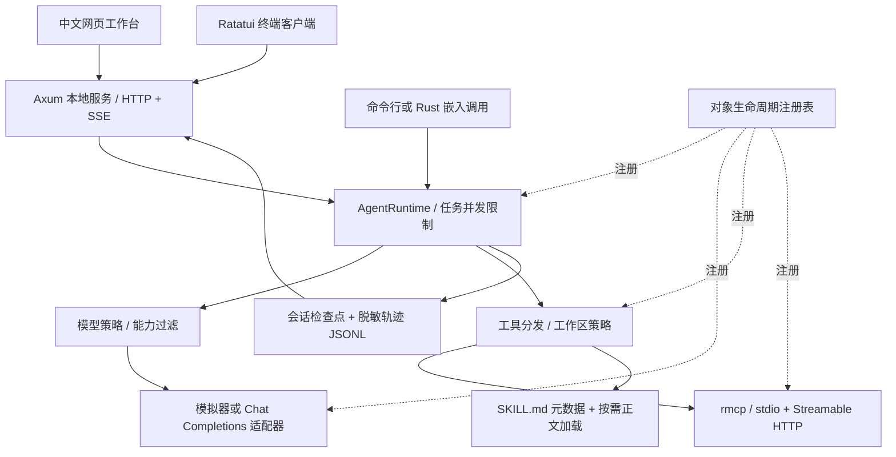

# Samho 架构说明

本文描述当前增量 Rust 重写实现，用于说明代码结构和服务边界，不表示已达到 Pi、DSH、ZCode 或 MCP 的全部功能对等。已完成能力与未完成项见[实现状态](implementation-status.md)。

## 一、共享服务边界

`samho-core` 负责异步运行时。`AgentRuntime`（Agent 运行时）验证配置、取得数据目录锁、发现技能（Skill）、连接 MCP 服务、注册对象（Object）、创建模型路由器和模型服务适配器（Provider），并管理会话与调用轨迹存储。任务执行通过 Rust API 提供。

`samho-cli` 是入口适配层。`serve` 创建一个运行时并提供本地 Web API；网页工作台与终端界面（TUI）都调用该 API，共享任务限制、会话、模型决策、对象元数据和轨迹事件。`run`、`inspect`、`replay` 是同一核心上的命令行适配入口。服务默认监听 `0.0.0.0` 以便局域网访问，并拒绝跨来源请求；没有身份认证，只应在可信局域网使用。

## 二、对象图与生命周期

`ObjectEnvelope`（对象描述封装）提供稳定 ID、类型、版本、依赖 ID、能力、标签和可序列化规范。`Object` 特征提供 `invoke`（调用）、`activate`（激活）和 `dispose`（释放）。注册表计算依赖拓扑激活顺序，在激活前拒绝缺失依赖或循环依赖，失败时回滚本次新激活对象，释放时按逆序处理。

当前注册表包含运行时 Agent、配置模型、内置和自定义工具、发现的技能、Session、Task 及 MCP 服务对象。对象层提供 scope、middleware、generation、lease、排空和失败回滚；自定义工具在注册锁下验证、激活，失败后移除。

这是当前借鉴 DSH 的边界。DSH 官方设计是“万物皆插件”（Everything is a Plugin）；本项目用统一对象身份与生命周期组织能力，实际操作仍保留专用 Rust 类型。热替换 fixture 已覆盖旧代际排空、租约释放和失败回滚；跨进程插件 ABI 与远程生产运维仍未宣称完成。

## 三、任务执行与模型路由

`TaskRequest`（任务请求）取得并发许可，获取或创建会话，产生根调用区段（root span），在重启后恢复未完成工具调用的观察状态，追加用户消息和显式技能，再保存会话检查点。自动请求由有序、可配置的关键词规则分类；模型按指定层级/模型、工具、图像、推理、上下文、预算、延迟和领域过滤。确定性评分选择候选，在 `model.route` 中记录拒绝项与选择理由。

当前定义六个策略层级：

| 标识 | 中文含义 | 策略定位 |
| --- | --- | --- |
| `nano` | 轻量 | 低复杂度轻量任务 |
| `fast` | 快速 | 优先响应速度的日常任务 |
| `balanced` | 均衡 | 常规质量、成本和延迟平衡 |
| `reasoning` | 推理 | 调试、重构与多步骤推理 |
| `frontier` | 前沿 | 架构、证明等高复杂度任务 |
| `specialist` | 专业 | 按领域约束或显式选择的专业模型 |

层级是使用者的策略标签，不是智力实测排名。供应商特有的 `reasoning_effort`（推理强度）是独立配置。内置适配器是明确标注的离线模拟器；真实请求使用 Chat Completions 兼容端点，不会静默回退为模拟结果。

循环检查取消、上下文容量、预算和轮次限制，流式调用模型，验证工具参数，执行工具，保存消息检查点，产生结束状态。上下文投影保留 system、必要工具观察并记录摘要 lineage；中断后的外部副作用不会自动重放。

## 四、调用轨迹与恢复

`EventLog`（事件日志）在异步互斥锁内分配单调递增序号，在持久化和广播前进行秘密信息脱敏，持久存储始终写入 JSONL（逐行 JSON）。`durable_logs` 额外控制每次追加后的 `sync_data` 强制落盘，不是是否写文件的开关。事件携带调用链、会话、区段、父区段、类型、对象 ID、时间戳和载荷。广播流有界，消费者落后时报告 `gap`（事件缺口）。

重启验证 JSONL 或 SQLite journal，只丢弃未终止的尾部片段，延续序号，并把运行中会话标记为 `interrupted`（已中断）。分页、rotation、retention、timeline/export 和 SSE gap 恢复均有 fixture。

轨迹默认省略正文。`log_content = true` 显式启用更多记录，仍进行脱敏。会话恢复独立保存完整脱敏消息，不受该开关影响。`GET /api/events` 支持游标分页、时间线和导出；`replay` 展示或导出事件，不再次执行外部调用。

## 五、MCP 与技能

MCP（模型上下文协议）使用 `rmcp 3.5.1`，支持 stdio（标准输入输出）和 Streamable HTTP（可流式 HTTP）。已实现并测试初始化、工具分页和调用、资源、资源模板、提示词、completion、roots、sampling、form elicitation、tasks、资源订阅、取消、超时、结构化错误、OAuth PKCE、子进程回收和工具列表代际替换。MCP 服务是独立对象，其公开工具进入统一工具命名空间。

客户端仍未覆盖 OAuth metadata discovery、动态 client registration、已连接 HTTP transport 的自动 token refresh、URL elicitation、modern `subscriptions/listen`、server/discover 生命周期、MRTR 非 task completion、stdio 自动重连、外部 JSON Schema `$ref` 和官方 conformance。对应方法返回明确未支持错误，或不在初始化能力中声明。[MCP 支持说明](mcp-support.md)是当前能力范围的依据。

技能发现带 YAML 文件头的 `SKILL.md`，校验名称和描述，以确定性顺序解决重复，立即提供元数据，按需加载正文。显式加载写入任务轨迹与会话；ignore、资源相对路径和 `allowed-tools` 权限有 fixture，来源热重载仍待扩展。

## 六、界面与 API

Web API 提供健康/状态/模型/对象/技能/会话摘要/会话详情、异步任务提交/状态/取消、历史事件和 SSE（服务器发送事件）轨迹流。网页通过真实 API 展示这些资源与路由细节。Ratatui TUI 具有 Unicode 安全布局、会话切换、任务提交、取消和轨迹显示。两个客户端共用一个运行时进程，不各自维护 Agent 循环。

## 七、后续设计增量

后续重点是完整 MCP conformance、第三方 Provider/Router 插件版本、外部存储与日志后端、跨平台生产运维、远程 Facet 进程隔离、主题/快捷键导入导出，以及同机 Pi/Rust 性能对照和长期 soak。

每项增量需要确定性样例、故障注入、恢复测试和基准报告，才可称为完成。
